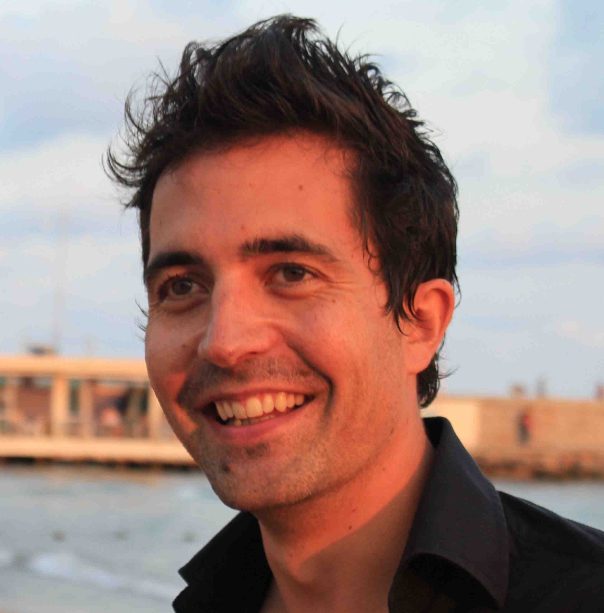
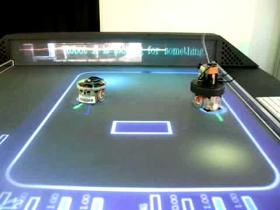
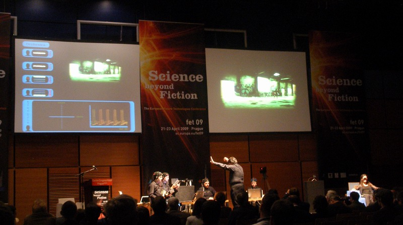
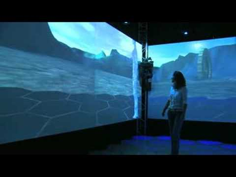
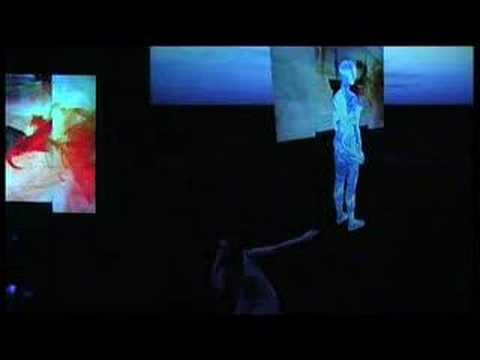

```{=html}
<header class="ab-mast">
  <div class="ab-index-line">
    <span>Sisyphe · About</span>
    <span class="ab-idx">Index <a href="#what-we-do">What we do</a> <a href="#who-runs-it">Who runs it</a> <a href="#background">Background</a> <a href="#elsewhere">Elsewhere</a></span>
  </div>
  <h1 class="ab-h1"><span class="ln">A small company</span> <span class="ln">with a long run-up<span class="visually-hidden">.</span><span class="rock" aria-hidden="true"></span></span></h1>
  <p class="ab-lede">Sisyphe builds AI for art, music and creative tools: agents that perceive a live environment and work inside it, whether that is a DAW, a stage, a gallery or an archive.</p>
</header>

<section class="ab-sec" id="what-we-do" aria-labelledby="what-we-do-h">
  <div class="ab-head">
    <span class="n">01</span>
    <h2 id="what-we-do-h">What Sisyphe does</h2>
    <p>A model that can see the whole environment and notice what changed is more useful than a chatbot beside it with a list of commands.</p>
  </div>

  <ol class="ab-log">
    <li>
      <span class="y">2023</span>
      <span class="k">Consulting</span>
      <p>Real-time conversational voice for Persona, music source separation advisory for Parts Order, fractional CTO for Tamada on an AI art curation engine for Visto.</p>
    </li>
    <li>
      <span class="y">2026</span>
      <span class="k">Products</span>
      <p><a href="projects.html#sideman">Sideman</a>, <a href="projects.html#kiln">Kiln</a> and <a href="projects.html#dandelion">Dandelion</a> followed. <a href="course.html">The course</a> teaches Sideman.</p>
    </li>
  </ol>

  <div class="ab-notes">
    <p>Sisyphe is independent of any employer. Client work never touches what the founder does at a day job, and the day job is not for hire here.</p>
  </div>
</section>

<section class="ab-sec" id="who-runs-it" aria-labelledby="who-runs-it-h">
  <div class="ab-head">
    <span class="n">02</span>
    <h2 id="who-runs-it-h">Who runs it</h2>
  </div>

  <div class="ab-founder">
    <figure class="ab-photo">
      
    </figure>
    <div class="ab-who">
      <h3>Sylvain Le Groux</h3>
      <p class="m">Founder · Ph.D., computer and cognitive science</p>
    </div>
    <div class="ab-bio">
      <p>Founded Sisyphe after two decades between research and industry: interactive music systems in labs in Barcelona and at Stanford, then speech and language models shipped to millions of users at Voicea and Cisco. Performs live melodic techno.</p>
      <p class="ab-go"><a href="https://ccrma.stanford.edu/~slegroux">The full story, papers and awards →</a></p>
    </div>
  </div>
</section>

<section class="ab-sec" id="background" aria-labelledby="background-h">
  <div class="ab-head">
    <span class="n">03 · Before Sisyphe</span>
    <h2 id="background-h">Before Sisyphe: twenty years of art and technology</h2>
    <p>Interactive music systems, performances and installations built in research labs in Barcelona, long before the company. The full portfolio is on <a href="https://ccrma.stanford.edu/~slegroux/portfolio/">Sylvain’s personal site</a>.</p>
  </div>

  <div class="ab-row ab-cat-head" aria-hidden="true"><span class="t"></span><span class="y">Year</span><span class="k">Work</span><span class="w">What it is</span><span class="go"></span></div>
  <ol class="ab-cat">
    <li><a class="ab-row" href="https://www.youtube.com/watch?v=HDmjGJ9sqeI"><span class="t"></span><span class="y">2010 · Sónar</span><span class="k">The Robot Arena</span><span class="w">Robots in an arena drive a score generated live.</span><span class="go">Watch →</span></a></li>
    <li><a class="ab-row" href="https://vimeo.com/35514990"><span class="t"></span><span class="y">2009</span><span class="k">The Brain Orchestra</span><span class="w">A string quartet played by four people’s brain signals.</span><span class="go">Watch →</span></a></li>
    <li><a class="ab-row" href="https://www.youtube.com/watch?v=XAlptm4aHNA"><span class="t"></span><span class="y">2007–2009</span><span class="k">XIM</span><span class="w">A mixed-reality room that composes music from how people move through it.</span><span class="go">Watch →</span></a></li>
    <li><a class="ab-row" href="https://www.youtube.com/watch?v=qln4f1kUpZU"><span class="t"></span><span class="y">2007</span><span class="k">Re(per)curso</span><span class="w">Dance, narrative, live synthetic composition and video on one stage.</span><span class="go">Watch →</span></a></li>
  </ol>
</section>

<div class="ab-pair">
  <section class="ab-sec" id="elsewhere" aria-labelledby="elsewhere-h">
    <div class="ab-head ab-head-s">
      <span class="n">04</span>
      <h2 id="elsewhere-h">Elsewhere</h2>
    </div>
    <dl class="ab-links">
      <div><dt>Research</dt><dd><a href="https://ccrma.stanford.edu/~slegroux">ccrma.stanford.edu/~slegroux</a></dd></div>
      <div><dt>Code</dt><dd><a href="https://github.com/slegroux">github.com/slegroux</a></dd></div>
      <div><dt>LinkedIn</dt><dd><a href="https://www.linkedin.com/in/slegroux">linkedin.com/in/slegroux</a></dd></div>
      <div><dt>Email</dt><dd><a href="mailto:sisyphe.lab@gmail.com">sisyphe.lab@gmail.com</a></dd></div>
    </dl>
  </section>

  <section class="ab-sec" id="llc" aria-labelledby="llc-h">
    <div class="ab-head ab-head-s">
      <span class="n">05</span>
      <h2 id="llc-h">Sisyphe LLC</h2>
    </div>
    <p class="ab-colophon">Santa Monica, California. The name is the French spelling of Sisyphus. The footer is Camus, with one word changed.</p>
  </section>
</div>

<section class="ab-closer" id="contact" aria-labelledby="contact-h">
  <h2 id="contact-h">Start a conversation.</h2>
  <div class="ab-cta">
    <p>Tell us what you are building and where it is stuck. You will get a reply from the person who would do the work.</p>
    <p class="btn-row"><a class="btn-accent" href="mailto:sisyphe.lab@gmail.com?subject=Working%20with%20Sisyphe">Write to us</a> <a class="btn-quiet" href="services.html">See services</a></p>
    <p class="addr">Or copy the address: <code>sisyphe.lab@gmail.com</code> <button type="button" class="copy-email" data-email="sisyphe.lab@gmail.com">Copy</button></p>
  </div>
</section>
```
