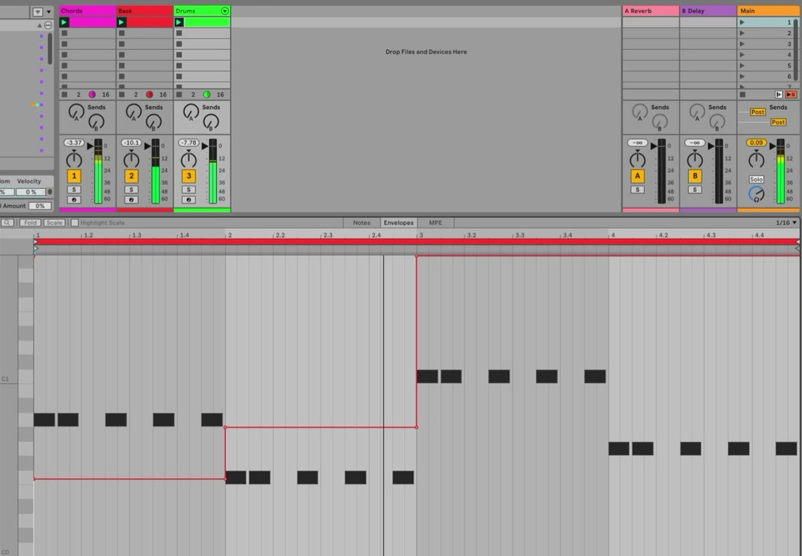
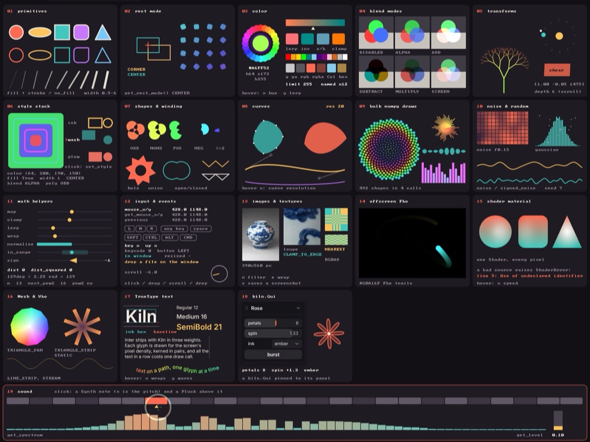
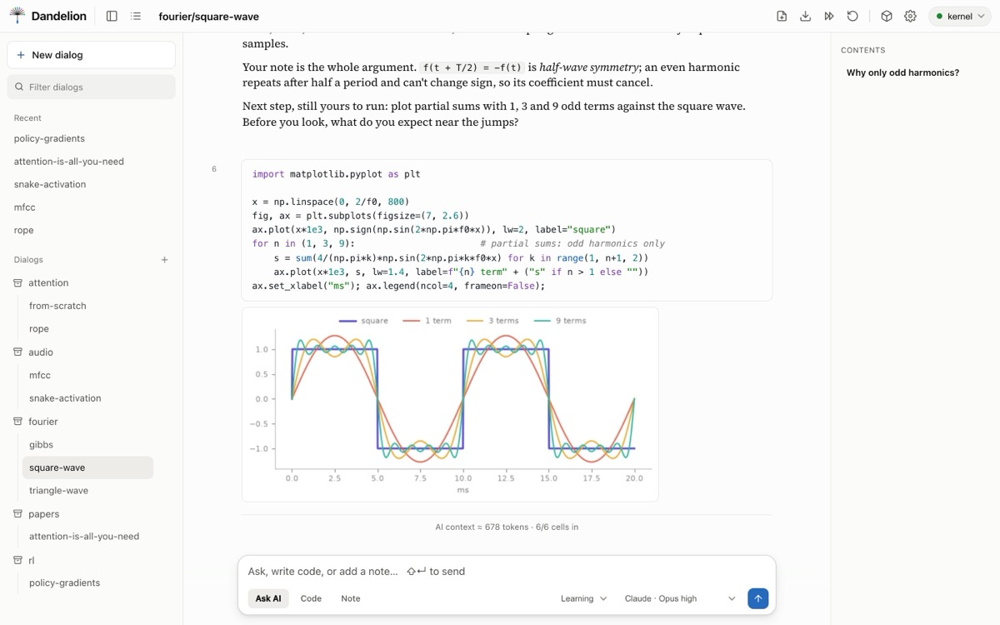
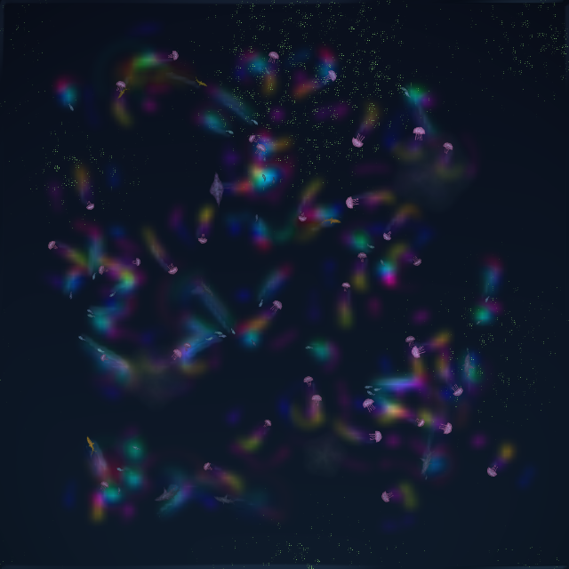
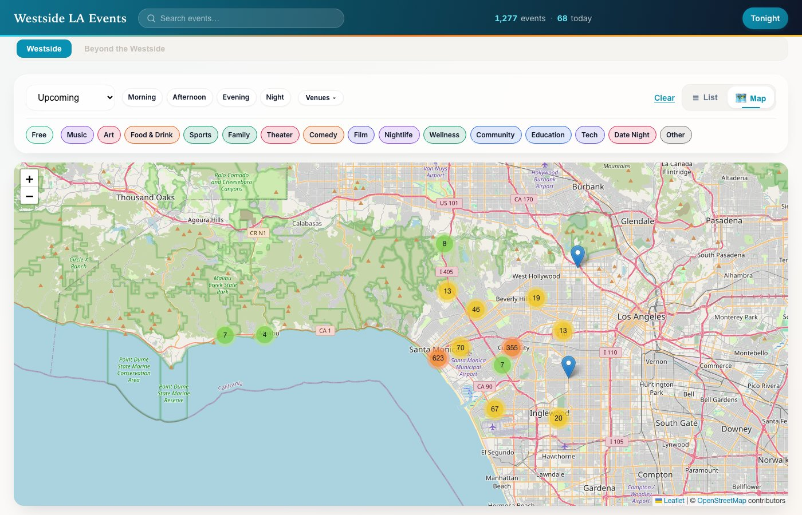

```{=html}
<header class="pj-mast">
  <div class="pj-index-line">
    <span>Sisyphe · Projects</span>
    <span class="pj-idx">Index <a href="#products">Products</a> <a href="#open-source">Open source</a> <a href="#own-work">Our own work</a> <a href="#contact">Contact</a></span>
  </div>
  <h1 class="pj-h1"><span class="ln">What we</span> <span class="ln">have built<span class="visually-hidden">.</span><span class="rock" aria-hidden="true"></span></span></h1>
  <p class="pj-lede">Products, public tools and our own projects, almost all of it since Sisyphe began in 2023. Each is tagged with the layers it works hardest on: <span class="lyr perceive">perceive</span>, <span class="lyr reason">reason</span>, <span class="lyr act">act</span>. For the two decades before, see <a href="about.html#background">the background</a>.</p>
</header>

<nav class="pj-index" aria-label="Index of projects">
  <div class="pj-ig pj-ix-head" aria-hidden="true">
    <span></span>
    <div class="pj-row"><span class="n">No.</span><span class="k">Work</span><span class="w">What it is</span><span class="d"><i class="perceive">P</i><i class="reason">R</i><i class="act">A</i></span><span class="s">Status</span><span class="y">Year</span></div>
  </div>
  <div class="pj-ig">
    <p class="pj-ig-k" id="ix-products">Products</p>
    <ol aria-labelledby="ix-products">
      <li><a class="pj-row" href="#sideman"><span class="n">01</span><span class="k">Sideman</span><span class="w">Ableton Live MCP server</span><span class="d" aria-hidden="true"><i class="perceive on"></i><i class="reason on"></i><i class="act on"></i></span><span class="s">Open source</span><span class="y">2026</span></a></li>
      <li><a class="pj-row" href="#kiln"><span class="n">02</span><span class="k">Kiln</span><span class="w">Creative-coding framework</span><span class="d" aria-hidden="true"><i class="perceive on"></i><i class="reason on"></i><i class="act on"></i></span><span class="s">In development</span><span class="y">2026</span></a></li>
      <li><a class="pj-row" href="#dandelion"><span class="n">03</span><span class="k">Dandelion</span><span class="w">Learning notebook</span><span class="d" aria-hidden="true"><i class="perceive on"></i><i class="reason on"></i><i class="act"></i></span><span class="s">Public</span><span class="y">2026</span></a></li>
    </ol>
  </div>
  <div class="pj-ig">
    <p class="pj-ig-k" id="ix-open-source">Open-source tools</p>
    <ol aria-labelledby="ix-open-source">
      <li><a class="pj-row" href="#roadie"><span class="n">04</span><span class="k">Roadie</span><span class="w">Stem separation for Ableton Live 12</span><span class="d" aria-hidden="true"><i class="perceive on"></i><i class="reason"></i><i class="act on"></i></span><span class="s">Open source</span><span class="y">2026</span></a></li>
      <li><a class="pj-row" href="#nimrod"><span class="n">05</span><span class="k">Nimrod</span><span class="w">Deep-learning framework</span><span class="d" aria-hidden="true"><i class="perceive on"></i><i class="reason on"></i><i class="act"></i></span><span class="s">Open source</span><span class="y">2023–</span></a></li>
    </ol>
  </div>
  <div class="pj-ig">
    <p class="pj-ig-k" id="ix-own-work">Our own work</p>
    <ol aria-labelledby="ix-own-work">
      <li><a class="pj-row" href="#dream-fauna"><span class="n">06</span><span class="k">Dream Fauna</span><span class="w">Generative-art instrument</span><span class="d" aria-hidden="true"><i class="perceive on"></i><i class="reason"></i><i class="act on"></i></span><span class="s">Personal</span><span class="y">2026</span></a></li>
      <li><a class="pj-row" href="#moving-paintings"><span class="n">07</span><span class="k">Moving Paintings</span><span class="w">Diffusion-animated paintings</span><span class="d" aria-hidden="true"><i class="perceive"></i><i class="reason"></i><i class="act on"></i></span><span class="s">Personal</span><span class="y">2022</span></a></li>
      <li><a class="pj-row" href="#westside"><span class="n">08</span><span class="k">Westside LA Events</span><span class="w">Events aggregator</span><span class="d" aria-hidden="true"><i class="perceive on"></i><i class="reason"></i><i class="act"></i></span><span class="s">Live</span><span class="y">2025–2026</span></a></li>
      <li><a class="pj-row" href="#bestiary"><span class="n">09</span><span class="k">Bestiary</span><span class="w">Simulation, sim-to-real</span><span class="d" aria-hidden="true"><i class="perceive on"></i><i class="reason"></i><i class="act on"></i></span><span class="s">Personal</span><span class="y">2026</span></a></li>
    </ol>
  </div>
</nav>

<section class="pj-sec" id="products" aria-labelledby="products-h">
  <span id="music" class="pj-old-anchor"></span><span id="tools" class="pj-old-anchor"></span>
  <div class="pj-head">
    <span class="n">01–03</span>
    <h2 id="products-h">Products</h2>
    <p>Software for Ableton Live, for sketching and for learning.</p>
  </div>

  <article class="pj-e e-l" id="sideman" aria-labelledby="sideman-h">
    <figure class="pj-fig framed">
      <div class="media"></div>
    </figure>
    <div class="pj-txt">
      <p class="pj-meta"><span class="n">01</span><span class="s">Product · Open source</span><span class="y">2026</span></p>
      <h3 id="sideman-h">Sideman</h3>
      <p class="pj-what">Ableton Live MCP server</p>
      <p class="pj-lyrs"><span class="lyr perceive">perceive</span><span class="lyr reason">reason</span><span class="lyr act">act</span></p>
      <p>Gives Claude the whole of Ableton Live through Live’s own object model. Observers report what you do by hand; thirty tools write into the Set with real undo.</p>
      <p class="pj-go"><a href="https://slegroux.github.io/sideman/">Sideman site →</a></p>
    </div>
  </article>

  <article class="pj-e e-full" id="kiln" aria-labelledby="kiln-h">
    <figure class="pj-fig pj-vid">
      <div class="media">
        <video poster="assets/hero/flocking.jpg" muted loop playsinline preload="metadata" aria-hidden="true"><source src="assets/hero/flocking-960.mp4" type="video/mp4" media="(max-width: 960px)"><source src="assets/hero/flocking.mp4" type="video/mp4"></video>
        <button class="vid-toggle" type="button" hidden>Pause<span class="visually-hidden"> the Kiln animation</span></button>
      </div>
      <figcaption class="cap"><span class="n">02a</span><span class="t">Ember sparks, flocking</span></figcaption>
    </figure>
    <div class="pj-txt">
      <p class="pj-meta"><span class="n">02</span><span class="s">In development</span><span class="y">2026</span></p>
      <h3 id="kiln-h">Kiln</h3>
      <p class="pj-what">Creative-coding framework</p>
      <p class="pj-lyrs"><span class="lyr perceive">perceive</span><span class="lyr reason">reason</span><span class="lyr act">act</span></p>
      <p>Sketch with agents. Sketch agents. Python on the GPU: a coding agent can look at what its sketch drew and fix it, and inside the sketch thousands of agents share one behaviour tree. Not public yet.</p>
    </div>
    <figure class="pj-fig pj-still framed">
      <div class="media"></div>
      <figcaption class="cap"><span class="n">02b</span><span class="t">Showcase window, drawn live by one Python sketch</span></figcaption>
    </figure>
  </article>

  <article class="pj-e e-r" id="dandelion" aria-labelledby="dandelion-h">
    <div class="pj-txt">
      <p class="pj-meta"><span class="n">03</span><span class="s">Public</span><span class="y">2026</span></p>
      <h3 id="dandelion-h">Dandelion</h3>
      <p class="pj-what">Learning notebook</p>
      <p class="pj-lyrs"><span class="lyr perceive">perceive</span><span class="lyr reason">reason</span></p>
      <p>A local-first notebook that teaches: the AI answers a hint or a guiding question at a time, and never runs a cell. Running the code stays the learner’s job. Formerly Pappus.</p>
      <p class="pj-go"><a href="https://slegroux.github.io/dandelion/">Dandelion site →</a></p>
    </div>
    <figure class="pj-fig framed">
      <div class="media"></div>
    </figure>
  </article>
</section>

<section class="pj-sec" id="open-source" aria-labelledby="open-source-h">
  <div class="pj-head">
    <span class="n">04–05</span>
    <h2 id="open-source-h">Open-source tools</h2>
    <p>Tools and frameworks we build on, for music and for training models.</p>
  </div>

  <div class="pj-pair">
    <article class="pj-e e-type" id="roadie" aria-labelledby="roadie-h">
      <div class="pj-txt">
        <p class="pj-meta"><span class="n">04</span><span class="s">Open source</span><span class="y">2026</span></p>
        <h3 id="roadie-h">Roadie</h3>
        <p class="pj-what">Stem separation for Ableton Live 12</p>
        <p class="pj-lyrs"><span class="lyr perceive">perceive</span><span class="lyr act">act</span></p>
        <p>From finished track to Live set: stems separated, drums split six ways, and loaded into your running Set through Sideman on the bar line, colour-coded and levelled.</p>
        <p class="pj-go"><a href="https://slegroux.github.io/roadie/">Roadie site →</a></p>
      </div>
    </article>

    <article class="pj-e e-type" id="nimrod" aria-labelledby="nimrod-h">
      <div class="pj-txt">
        <p class="pj-meta"><span class="n">05</span><span class="s">Open source</span><span class="y">2023–</span></p>
        <h3 id="nimrod-h">Nimrod</h3>
        <p class="pj-what">Deep-learning framework</p>
        <p class="pj-lyrs"><span class="lyr perceive">perceive</span><span class="lyr reason">reason</span></p>
        <p>Minimal, on PyTorch: each experiment one Hydra config. Built for speech, audio and language modelling; on PyPI as <code>slg-nimrod</code>.</p>
        <p class="pj-go"><a href="https://slegroux.github.io/nimrod/">Nimrod docs →</a></p>
      </div>
    </article>
  </div>
</section>

<section class="pj-sec" id="own-work" aria-labelledby="own-work-h">
  <span id="agents" class="pj-old-anchor"></span><span id="creative-ml" class="pj-old-anchor"></span><span id="learning-culture" class="pj-old-anchor"></span>
  <div class="pj-head">
    <span class="n">06–09</span>
    <h2 id="own-work-h">Our own work</h2>
    <p>Personal pieces: an instrument, paintings in motion, a city’s cultural life, a simulator.</p>
  </div>

  <article class="pj-e e-sq" id="dream-fauna" aria-labelledby="dream-fauna-h">
    <figure class="pj-fig">
      <div class="media"></div>
    </figure>
    <div class="pj-txt">
      <p class="pj-meta"><span class="n">06</span><span class="s">Personal</span><span class="y">2026</span></p>
      <h3 id="dream-fauna-h">Dream Fauna</h3>
      <p class="pj-what">Generative-art instrument</p>
      <p class="pj-lyrs"><span class="lyr perceive">perceive</span><span class="lyr act">act</span></p>
      <p>Watercolour creatures, lifted into 3D by an AI pipeline, live in an artificial ecosystem whose swarm composes the music. In the live set, the music drives the swarm back.</p>
      <p class="pj-go"><a href="https://ccrma.stanford.edu/~slegroux/portfolio/performances/dreamfauna.html">About Dream Fauna →</a></p>
    </div>
  </article>

  <article class="pj-e e-small" id="moving-paintings" aria-labelledby="moving-paintings-h">
    <div class="pj-txt">
      <p class="pj-meta"><span class="n">07</span><span class="s">Personal</span><span class="y">2022</span></p>
      <h3 id="moving-paintings-h">Moving Paintings</h3>
      <p class="pj-what">Diffusion-animated paintings</p>
      <p class="pj-lyrs"><span class="lyr act">act</span></p>
      <p>Still paintings dreamed into motion with diffusion models, one artwork as the seed of each: seven pieces, from Bosch to Basquiat.</p>
      <p class="pj-go"><a href="https://ccrma.stanford.edu/~slegroux/portfolio/performances/moving_paintings.html">Watch the series →</a></p>
    </div>
    <figure class="pj-fig pj-vid">
      <div class="media">
        <video src="assets/work/bosch.mp4" poster="assets/work/bosch.jpg" muted loop playsinline preload="metadata" aria-hidden="true"></video>
        <button class="vid-toggle" type="button" hidden>Pause<span class="visually-hidden"> the Bosch animation</span></button>
      </div>
      <figcaption class="cap"><span class="n">07a</span><span class="t">Diffusing Bosch</span></figcaption>
    </figure>
  </article>

  <article class="pj-e e-l e-wide" id="westside" aria-labelledby="westside-h">
    <figure class="pj-fig framed">
      <div class="media"></div>
    </figure>
    <div class="pj-txt">
      <p class="pj-meta"><span class="n">08</span><span class="s">Live</span><span class="y">2025–2026</span></p>
      <h3 id="westside-h">Westside LA Events</h3>
      <p class="pj-what">Events aggregator</p>
      <p class="pj-lyrs"><span class="lyr perceive">perceive</span></p>
      <p>Sixty scrapers over venues, museums and community calendars on LA’s Westside, unified into one search with maps. A city as an archive, at civic scale.</p>
      <p class="pj-go"><a href="https://westside-events-406046958598.us-west1.run.app">Open the app →</a> <span class="wake">It may take a few seconds to wake.</span></p>
    </div>
  </article>

  <article class="pj-e e-row" id="bestiary" aria-labelledby="bestiary-h">
    <div class="pj-txt">
      <p class="pj-meta"><span class="n">09</span><span class="s">Personal</span><span class="y">2026</span></p>
      <h3 id="bestiary-h">Bestiary</h3>
      <p class="pj-what">Simulation, sim-to-real</p>
      <p class="pj-lyrs"><span class="lyr perceive">perceive</span><span class="lyr act">act</span></p>
    </div>
    <div class="pj-body">
      <p>A MuJoCo simulator for things that move. Its first creature is a quadrotor that speaks MAVLink, flown headless at 30 to 60 times real time.</p>
    </div>
  </article>
</section>

<p class="pj-note">Client engagements are on <a href="services.html#clients">Services</a>.</p>

<section class="pj-closer" id="contact" aria-labelledby="contact-h">
  <h2 id="contact-h">Start a conversation.</h2>
  <div class="pj-cta">
    <p>Tell us what you are building and where it is stuck. You will get a reply from the person who would do the work.</p>
    <p class="btn-row"><a class="btn-accent" href="mailto:sisyphe.lab@gmail.com?subject=Working%20with%20Sisyphe">Write to us</a> <a class="btn-quiet" href="services.html">See services</a></p>
    <p class="addr">Or copy the address: <code>sisyphe.lab@gmail.com</code> <button type="button" class="copy-email" data-email="sisyphe.lab@gmail.com">Copy</button></p>
  </div>
</section>

<script>
/* Project videos. Playback starts here, never from markup: only on screen, never under
   reduced motion, and never after the visitor paused that video. Without JS the poster
   shows and the Pause buttons stay hidden. */
(function () {
  var items = Array.prototype.map.call(document.querySelectorAll('.pj-vid'), function (f) {
    return { v: f.querySelector('video'), b: f.querySelector('.vid-toggle'), held: false, on: false };
  }).filter(function (it) { return it.v && it.b; });
  if (!items.length) return;
  var mq = window.matchMedia('(prefers-reduced-motion: reduce)');
  var apply = function () {
    items.forEach(function (it) {
      if (!mq.matches && !it.held && it.on) { var p = it.v.play(); if (p && p.catch) p.catch(function () {}); }
      else { it.v.pause(); }
      it.b.hidden = mq.matches;
      it.b.firstChild.nodeValue = it.held ? 'Play' : 'Pause';
    });
  };
  items.forEach(function (it) {
    it.b.addEventListener('click', function () { it.held = !it.held; apply(); });
  });
  if (mq.addEventListener) mq.addEventListener('change', apply); else if (mq.addListener) mq.addListener(apply);
  if ('IntersectionObserver' in window) {
    var io = new IntersectionObserver(function (es) {
      es.forEach(function (e) { items.forEach(function (it) { if (it.v === e.target) it.on = e.isIntersecting; }); });
      apply();
    }, { threshold: 0.15 });
    items.forEach(function (it) { io.observe(it.v); });
  } else { items.forEach(function (it) { it.on = true; }); }
  apply();
})();
</script>
```
