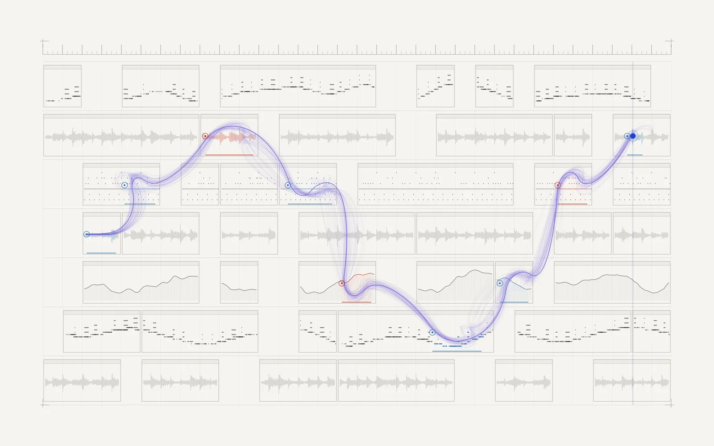
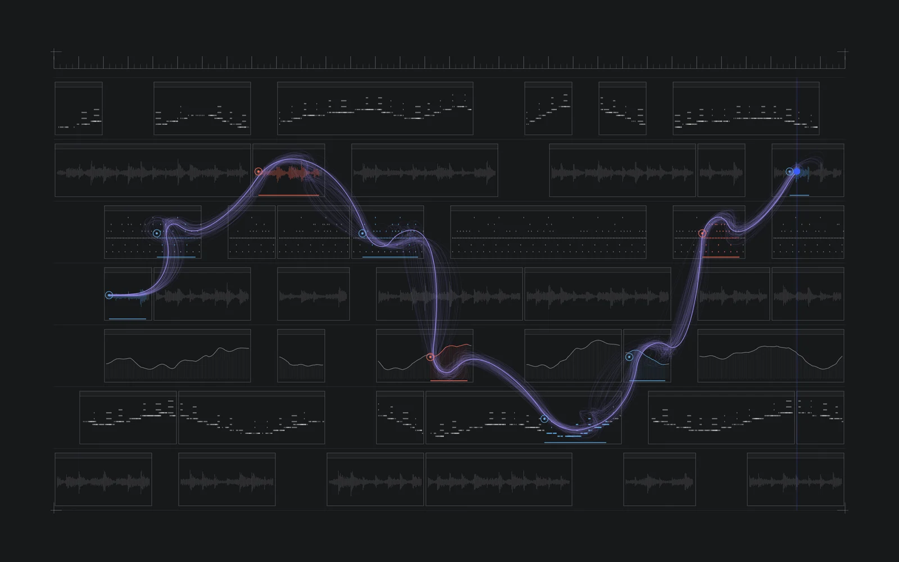
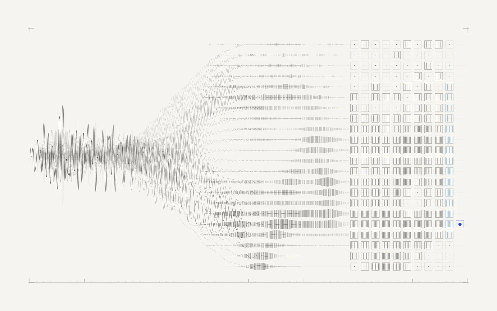
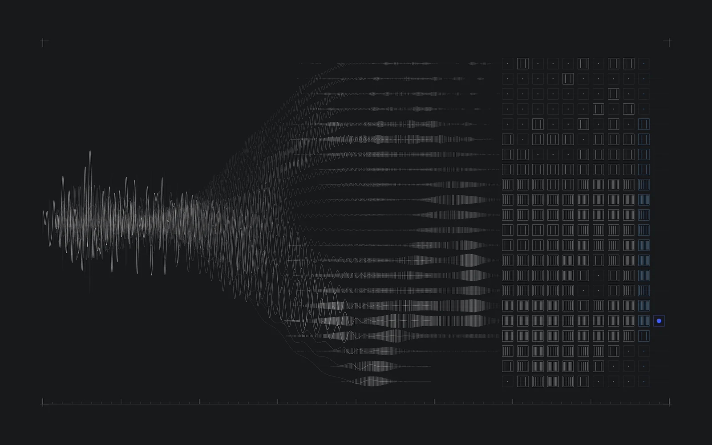
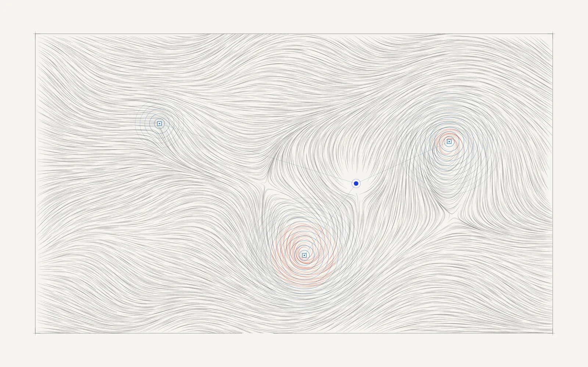
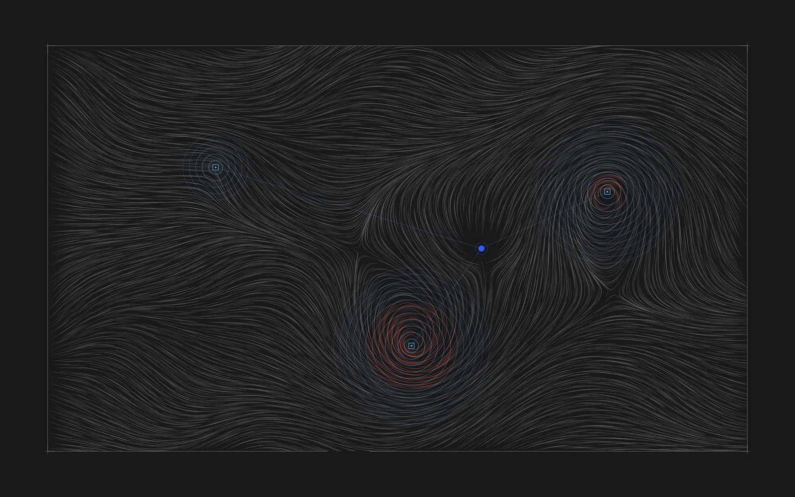
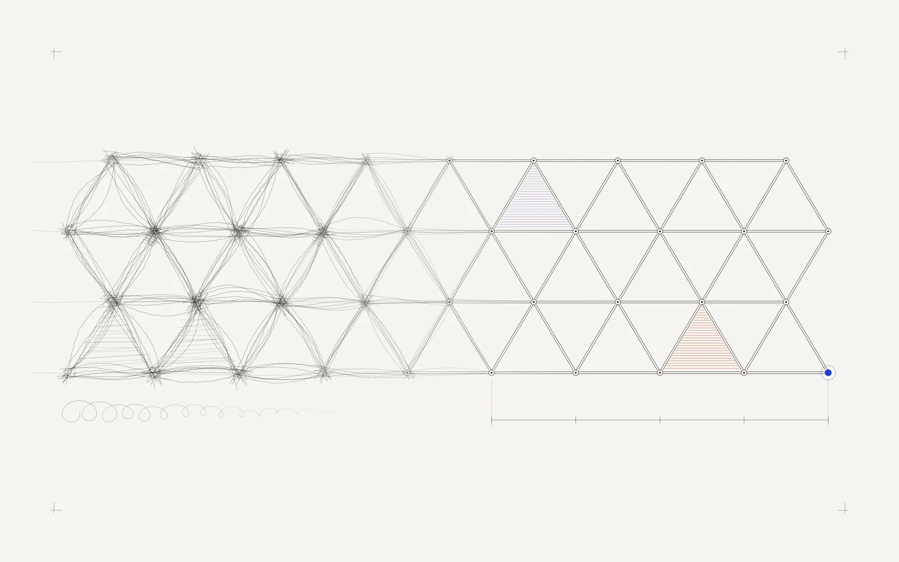
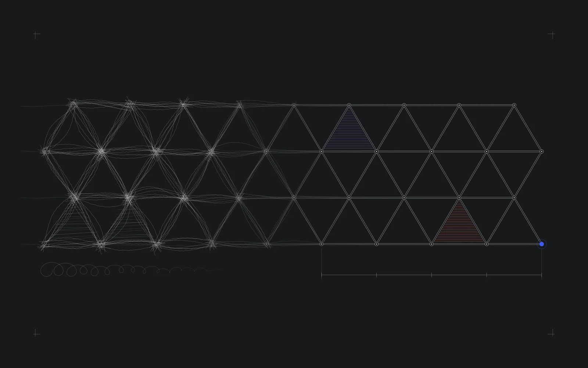
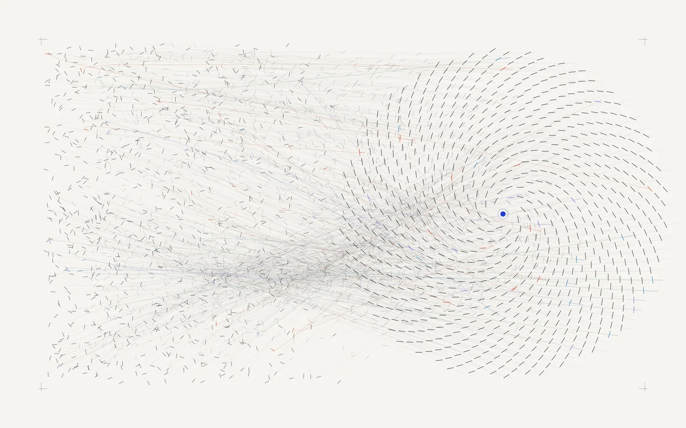
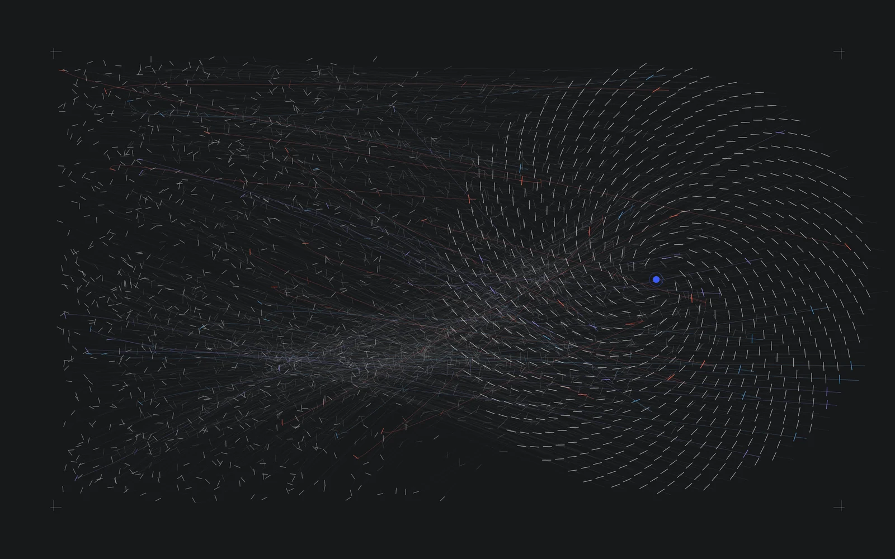

```{=html}
<header class="sv-mast">
  <div class="sv-index-line">
    <span>Sisyphe · Services</span>
    <span class="sv-idx">Index <a href="#build">Build</a> <a href="#advise">Advise</a> <a href="#teach">Teach</a> <a href="#clients">Clients</a> <a href="#contact">Contact</a></span>
  </div>
  <h1 class="sv-h1"><span class="ln">Build, advise,</span> <span class="ln">teach<span class="visually-hidden">.</span><span class="rock" aria-hidden="true"></span></span></h1>
  <p class="sv-lede">Sisyphe is small on purpose. One senior engineer, with trusted collaborators when the work needs them, on problems where the model has to meet a real instrument, a real stage, a real signal or a real collection. If you are not sure your problem fits, write anyway.</p>
</header>

<nav class="sv-toc" aria-label="Services">
  <a href="#build"><span class="n">01</span><span class="k">Build</span><span class="l">We build it.</span><span class="s">Agents · audio ML · installations</span></a>
  <a href="#advise"><span class="n">02</span><span class="k">Advise</span><span class="l">We check it before you build.</span><span class="s">Research to product · fractional CTO</span></a>
  <a href="#teach"><span class="n">03</span><span class="k">Teach</span><span class="l">We teach your team.</span><span class="s">Workshops · courses</span></a>
</nav>

<section class="sv-sec" id="build" aria-labelledby="build-h">
  <div class="sv-head">
    <span class="n">01</span>
    <h2 id="build-h">Build</h2>
    <p>Working software in your repo, measured against the real environment it has to run in.</p>
  </div>


  <article class="sv-item">
    <div class="sv-say">
      <h3>Agents inside creative tools</h3>
      <p class="sv-out">You get an agent that can operate your whole application, and an evaluation that tells you when its coverage slips.</p>
    </div>
    <div class="sv-do">
      <figure class="sv-art">
        
        
        <figcaption class="cap"><span class="n">01a</span><span class="t">An agent’s path through a session’s tracks and clips, reading some and editing others · drawn with <a href="projects.html#kiln">Kiln</a></span></figcaption>
      </figure>
      <p>MCP servers and tool design for DAWs, plug-ins, creative apps and collections. We decide what the model should see and build the bridge into your object model or archive.</p>
      <dl class="sv-refs">
        <div><dt>Our work</dt><dd><a href="projects.html#sideman">Sideman</a></dd></div>
      </dl>
    </div>
  </article>

  <article class="sv-item">
    <div class="sv-say">
      <h3>Music, audio and voice ML</h3>
      <p class="sv-out">You get music and audio models that hold up in a product, not only on a benchmark.</p>
    </div>
    <div class="sv-do">
      <figure class="sv-art">
        
        
        <figcaption class="cap"><span class="n">01b</span><span class="t">A voice waveform split into its partials, then a spectrogram, then discrete tokens · drawn with <a href="projects.html#kiln">Kiln</a></span></figcaption>
      </figure>
      <p>Music source separation, audio classification and recommendation, speech recognition and synthesis. Data pipelines, training, evaluation, and getting a model into a product.</p>
      <dl class="sv-refs">
        <div><dt>Our work</dt><dd><a href="projects.html#roadie">Roadie</a> · <a href="projects.html#nimrod">Nimrod</a></dd></div>
        <div><dt>Clients</dt><dd><a href="#persona">Persona</a> · <a href="#parts-order">Parts Order</a></dd></div>
      </dl>
    </div>
  </article>

  <article class="sv-item">
    <div class="sv-say">
      <h3>Interactive art and installations</h3>
      <p class="sv-out">You get a real-time system that answers people, sensors or signals, with a mapping you can defend.</p>
    </div>
    <div class="sv-do">
      <figure class="sv-art">
        
        
        <figcaption class="cap"><span class="n">01c</span><span class="t">Three sensors read one visitor and bend a field of strokes across a room · drawn with <a href="projects.html#kiln">Kiln</a></span></figcaption>
      </figure>
      <p>Embodied AI for the stage and the gallery: real-time composition, sound, light and machines that respond to sensors, biosignals, movement or game state. Installations, performances, museum and gallery prototypes.</p>
      <dl class="sv-refs">
        <div><dt>Our work</dt><dd><a href="projects.html#dream-fauna">Dream Fauna</a> (personal)</dd></div>
      </dl>
    </div>
  </article>
</section>

<section class="sv-sec" id="advise" aria-labelledby="advise-h">
  <div class="sv-head">
    <span class="n">02</span>
    <h2 id="advise-h">Advise</h2>
    <p>Read the paper, run the experiment, and say plainly what will work before you build it.</p>
  </div>

  <article class="sv-item">
    <div class="sv-say">
      <h3>Research to product, fractional CTO, scientific advice</h3>
      <p class="sv-out">You get a senior second opinion, or your prototype turned into software, before you commit a team to it.</p>
    </div>
    <div class="sv-do">
      <figure class="sv-art">
        
        
        <figcaption class="cap"><span class="n">02a</span><span class="t">One structure, sketched loose on the left and built clean on the right · drawn with <a href="projects.html#kiln">Kiln</a></span></figcaption>
      </figure>
      <p>For creative-tech teams and cultural institutions with a paper, a lab prototype or a collection that needs to become software. We talk to the scientists and ship the code, or sit beside your team as a fractional CTO or scientific advisor.</p>
      <dl class="sv-refs">
        <div><dt>Clients</dt><dd><a href="#tamada-visto">Tamada × Visto</a> · <a href="#parts-order">Parts Order</a></dd></div>
      </dl>
    </div>
  </article>
</section>

<section class="sv-sec" id="teach" aria-labelledby="teach-h">
  <div class="sv-head">
    <span class="n">03</span>
    <h2 id="teach-h">Teach</h2>
    <p>Workshops and courses for studios, schools and art programs.</p>
  </div>


  <article class="sv-item">
    <div class="sv-say">
      <h3>Teaching and workshops</h3>
      <p class="sv-out">You get a team that can build and run agents without us.</p>
    </div>
    <div class="sv-do">
      <figure class="sv-art">
        
        
        <figcaption class="cap"><span class="n">03a</span><span class="t">Scattered marks, each an agent, finding their place in one shared pattern · drawn with <a href="projects.html#kiln">Kiln</a></span></figcaption>
      </figure>
      <p>Sideman workshops for studios, schools and labs, from a day to a term, from “what’s in my Set?” to a finished track. Custom courses on agents for creative tools, audio machine learning and sensor-to-actuator systems.</p>
      <dl class="sv-refs">
        <div><dt>Our work</dt><dd><a href="course.html">The Sideman course</a> · <a href="projects.html#dandelion">Dandelion</a></dd></div>
      </dl>
    </div>
  </article>
</section>

<section class="sv-clients" id="clients" aria-labelledby="clients-h">
  <div class="sv-head sv-head-s">
    <h2 id="clients-h">Client work</h2>
    <p>Engagements for companies building AI into creative, cultural and voice products.</p>
  </div>
  <ul class="sv-cl">
    <li id="tamada-visto"><h3>Tamada × Visto</h3><span class="m">Fractional CTO · 2023–2025</span><p>An AI curation engine for <a href="https://www.visto.art/">Visto</a>, the art consultancy that builds collections for luxury hotels and landmark destinations: search by text or by image, taken from prototype to product with a team.</p></li>
    <li id="persona"><h3>Persona</h3><span class="m">ML engineer, embedded · 2023–2025</span><p>Real-time conversational voice pipelines, built inside the product team.</p></li>
    <li id="parts-order"><h3>Parts Order</h3><span class="m">Scientific advisor · 2023–2025</span><p>Scientific advice on music source separation.</p></li>
  </ul>
  <p class="sv-bg">For the two decades before Sisyphe, see <a href="about.html#background">the background</a>.</p>
</section>

<section class="sv-how" aria-labelledby="how-h">
  <h2 id="how-h">How it works</h2>
  <ol class="sv-steps">
    <li><span class="n" aria-hidden="true">1</span><h3>A written brief</h3><p>Half a page: what you are building, where it is stuck, what a demo would need to show. We reply with a scope, a number of weeks and a price.</p></li>
    <li><span class="n" aria-hidden="true">2</span><h3>Two to eight weeks</h3><p>A fixed engagement with a clear question. Working code in your repo from the first week, a check-in each week, and no open-ended retainers.</p></li>
    <li><span class="n" aria-hidden="true">3</span><h3>A demo, then a decision</h3><p>It ends with the work running in front of you and a written account of what worked and what did not. You decide what happens next.</p></li>
  </ol>
  <dl class="sv-terms">
    <div><dt>Advisory</dt><dd>The other shape: a few hours a month to review architecture, models or an agent design before you commit a team to it.</dd></div>
    <div><dt>Open source first</dt><dd>If the work belongs in Sideman or a public library, we will say so and price it accordingly.</dd></div>
  </dl>
</section>

<section class="sv-closer" id="contact" aria-labelledby="contact-h">
  <h2 id="contact-h">Start a conversation.</h2>
  <div class="sv-cta">
    <p>Write with what you are building and where it is stuck. You will get a reply from the person who would do the work.</p>
    <p class="btn-row"><a class="btn-accent" href="mailto:sisyphe.lab@gmail.com?subject=Working%20with%20Sisyphe">Write to us</a></p>
    <p class="addr">Or copy the address: <code>sisyphe.lab@gmail.com</code> <button type="button" class="copy-email" data-email="sisyphe.lab@gmail.com">Copy</button></p>
  </div>
</section>
```
